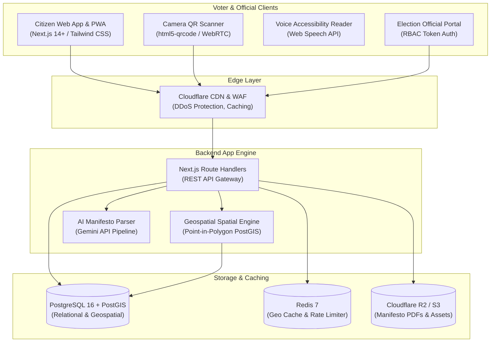

# 🗳️ Smart Voter — Zero Paper Waste Digital Election Platform

[](https://nextjs.org/)
[](https://www.typescriptlang.org/)
[](https://tailwindcss.com/)
[](https://www.postgresql.org/)
[](https://postgis.net/)
[](LICENSE)

> **Eliminating roadside paper election waste through verified digital manifestos, GPS-based constituency lookup, camera QR scanning, and side-by-side policy comparisons.**

---

## 🌍 The Problem

During election seasons, **over 500 million single-use PVC flex banners, paper posters, and flyers** are printed and plastered across roadside poles, trees, and walls. Within 48 hours of voting, the vast majority end up in storm drains, waterways, or landfills, generating hundreds of tons of non-biodegradable waste.

At the same time, voters struggle to find unfiltered information:
- Official candidate criminal disclosures (Form 26 affidavits) are buried in complex government PDF registries.
- Manifestos are often 50+ page unindexed documents that voters rarely read in full.
- Citizens frequently don't know their designated polling booth room, queue length, or required photo identification.

---

## 💡 The Solution: Smart Voter

**Smart Voter** replaces roadside paper banners with **reusable eco-stands featuring permanent QR codes**. Citizens point their smartphone camera at any campaign stand to instantly access verified candidate affidavits, AI-summarized manifestos, side-by-side decision matrices, and local polling booth navigation.

---

## ✨ Key Features

### 📸 1. Live WebRTC Camera QR Scanner
- Real-time video stream using `html5-qrcode` to scan physical roadside eco-stands.
- Interactive audio confirmation chime (Web Audio API) and confetti celebratory animation (`canvas-confetti`).
- Image file upload fallback for scanning saved photos of banners.
- Live paper-waste ledger: records +2 posters saved per digital scan.

### 📍 2. Geospatial Constituency Lookup Engine
- **GPS Point-in-Polygon**: Uses PostGIS `ST_Contains(boundary, ST_SetSRID(ST_Point(lng, lat), 4326))` to pinpoint exact parliamentary and assembly constituencies.
- **Pincode Resolution**: Instant 6-digit postal code fallback lookup.

### 🎙️ 3. Multilingual Audio Accessibility Reader
- Native Web Speech API integration (`window.speechSynthesis`) designed for elderly and visually impaired citizens.
- Supports **English**, **हिंदी (Hindi)**, **ಕನ್ನಡ (Kannada)**, and **मराठी (Marathi)** with native accents (`hi-IN`, `kn-IN`, `mr-IN`, `en-IN`).
- Animated voice equalizer with play, pause, and stop controls.

### ⚖️ 4. Side-by-Side Candidate Comparison Matrix
- Compare up to 3 candidates simultaneously across:
  - Form 26 Affidavit disclosures (Clean Record vs Criminal Disclosures).
  - Movable & Immovable Assets vs Declared Bank Liabilities.
  - Policy positions on *Economy & Jobs*, *Healthcare*, *Green & Climate*, and *Transit*.

### 🎫 5. Digital Voter Slip & Polling Booth Navigator
- Generates an official, printable Digital Voter Slip complete with serial barcode.
- Displays polling booth building, room number, part number, and wheelchair ramp access.
- Live queue time estimates (*Low < 10 mins*, *Moderate 15–30 mins*, *Busy > 45 mins*).
- One-click turn-by-turn navigation via Google Maps.

### 🏛️ 6. Civic Issues & Candidate Accountability Board
- Crowdsourced community grievance feed where residents report ward problems (*Potholes, Waterlogging, Smog*).
- Community upvoting to surface the most urgent neighborhood issues.
- Displays which running candidates have officially pledged to solve each problem in their manifesto.

### 🖨️ 7. 300-DPI High-Res Eco-Poster Stand Generator
- Generates standardized, print-ready vector campaign posters for eco-stands.
- Features candidate photo, party symbol, ECI registration number, and scannable QR code.

### 🛡️ 8. Election Official Admin Portal (RBAC)
- Role-Based Access Control for Returning Officers to audit affidavits.
- One-click verification approval or revocation.
- AI Manifesto ingestion pipeline (powered by Gemini AI) to extract and categorize campaign pledges.

---

## 🏗️ System Architecture



---

## 💻 Tech Stack

| Layer | Technology | Purpose |
| :--- | :--- | :--- |
| **Framework** | Next.js 14.2 (App Router) | Server-Side Rendering (SSR), API routes, and PWA capability |
| **Language** | TypeScript 5.6 | Strict end-to-end type safety |
| **Styling** | Tailwind CSS 3.4 | Utility-first responsive design |
| **Icons** | Lucide React | Consistent accessible iconography |
| **Database** | PostgreSQL 16 + PostGIS 3.4 | Relational storage & geospatial boundary matching |
| **Caching** | Redis 7 | Sub-millisecond geolocation caching & rate limiting |
| **Camera Scanner** | `html5-qrcode` | Cross-browser WebRTC camera barcode & QR decoding |
| **Speech** | Web Speech API | Client-side zero-dependency text-to-speech audio reader |
| **AI Engine** | Gemini API | Multi-lingual manifesto summarization & policy extraction |

---

## 📁 Project Structure

```text
smart-voter/
├── database/
│   └── schema.sql                 # Complete PostgreSQL + PostGIS DDL
├── public/
│   └── manifest.json              # Progressive Web App (PWA) manifest
├── src/
│   ├── app/
│   │   ├── api/
│   │   │   ├── admin/verify/      # Officer RBAC verification endpoint
│   │   │   ├── candidates/        # Candidate directory & detail endpoints
│   │   │   │   └── by-location/   # GPS & Pincode spatial resolution
│   │   │   ├── constituencies/    # Constituency boundary metadata
│   │   │   ├── eco-stats/         # Live paper savings & CO2 metrics
│   │   │   ├── issues/            # Civic issue reporting & upvotes
│   │   │   ├── manifestos/        # AI manifesto summarizer
│   │   │   ├── qr/                # Camera QR scan & poster generator
│   │   │   └── voter-slip/        # Digital voter slip & polling lookup
│   │   ├── globals.css            # Tailwind directives & custom scrollbars
│   │   ├── layout.tsx             # Root layout with PWA metadata
│   │   └── page.tsx               # Primary single-page application dashboard
│   ├── components/
│   │   ├── AdminPortal.tsx        # Returning Officer & Party dashboard
│   │   ├── AudioManifestoReader.tsx # Multilingual Web Speech voice reader
│   │   ├── CandidateCard.tsx      # Primary candidate profile card
│   │   ├── CandidateDetailModal.tsx # Full Form 26 affidavit & manifesto modal
│   │   ├── CivicIssuesBoard.tsx   # Crowdsourced ward grievance tracker
│   │   ├── ComparisonDrawer.tsx   # Side-by-side decision matrix
│   │   ├── ConstituencySelector.tsx # GPS auto-detect & Pincode search
│   │   ├── DigitalVoterSlipModal.tsx # Official voter slip & booth navigator
│   │   ├── EcoImpactBanner.tsx    # Live environmental metric counter
│   │   ├── LiveCameraQrScanner.tsx # WebRTC camera QR scanner modal
│   │   ├── Navbar.tsx             # Responsive header navigation
│   │   └── PrintablePosterCanvas.tsx # 300-DPI campaign stand generator
│   ├── lib/
│   │   ├── data-store.ts          # Seeded relational in-memory database store
│   │   └── utils.ts               # Currency formatting, Haversine geo formula
│   └── types/
│       └── index.ts               # TypeScript data models and interfaces
├── docker-compose.yml             # Local PostGIS 16 + Redis 7 setup
├── package.json
├── tailwind.config.js
└── tsconfig.json
```

---

## ⚡ Quick Start

### Prerequisites
- **Node.js**: v18.0.0 or higher (Tested on Node v24)
- **npm** or **pnpm**
- *(Optional)* **Docker & Docker Compose** (for PostgreSQL + PostGIS)

### 1. Clone the Repository
```bash
git clone https://github.com/your-username/smart-voter.git
cd smart-voter
```

### 2. Install Dependencies
```bash
npm install
```

### 3. Run the Development Server
```bash
npm run dev
```
Open **[http://localhost:3000](http://localhost:3000)** in your browser.

### 4. Build for Production
```bash
npm run build
npm start
```

---

## 🐳 Running with Docker (PostgreSQL + PostGIS)

To spin up a production-ready PostgreSQL 16 container with the PostGIS extension:

```bash
docker compose up -d
```

This will automatically:
1. Start PostgreSQL with PostGIS on port `5432`.
2. Start Redis 7 on port `6379`.
3. Apply the database schema from [`database/schema.sql`](database/schema.sql).

---

## 📡 REST API Reference

| Method | Endpoint | Description |
| :--- | :--- | :--- |
| `GET` | `/api/candidates/by-location?lat=&lng=&pincode=` | Resolves GPS coordinates or Pincode to a constituency and lists candidates |
| `GET` | `/api/candidates` | List candidates with optional party or status filters |
| `GET` | `/api/candidates/:id` | Fetch candidate affidavit, assets, and manifesto |
| `POST`| `/api/candidates` | Register a new candidate for ECI verification |
| `GET` | `/api/constituencies` | List all constituencies and boundaries |
| `GET` | `/api/voter-slip?q=` | Search digital voter slip by EPIC number or Name |
| `GET` | `/api/issues?constituencyId=` | Retrieve community grievances for a constituency |
| `POST`| `/api/issues` | Report a new ward civic issue |
| `POST`| `/api/issues/upvote` | Upvote an urgent community issue |
| `POST`| `/api/manifestos/summarize` | AI-powered multi-category extraction from manifesto text |
| `POST`| `/api/qr/scan` | Decode roadside poster QR hash & increment paper savings |
| `POST`| `/api/qr/generate` | Generate trackable QR code for campaign stands |
| `POST`| `/api/admin/verify` | Election Officer verification approval/rejection (RBAC) |
| `GET` | `/api/eco-stats` | Live counter of paper saved, trees preserved, and CO2 avoided |

---

## 🌿 Eco-Impact Formula

The real-time environmental metrics are calculated using verified lifecycle analysis of 120gsm election paper flyers and PVC flex banners:

$$\text{Posters Avoided} = 2 \times \text{Total QR Scans}$$

$$\text{Trees Preserved} = \frac{\text{Posters Avoided}}{1250}$$

$$\text{CO}_2\text{ Mitigated (kg)} = \text{Posters Avoided} \times 0.12\text{ kg}$$

$$\text{Plastic Flex Avoided (kg)} = \text{Posters Avoided} \times 0.08\text{ kg}$$

$$\text{Water Conserved (L)} = \text{Posters Avoided} \times 10\text{ Liters}$$

---

## 🤝 Contributing

Contributions are welcome! Please follow these steps:
1. Fork the project.
2. Create your feature branch (`git checkout -b feature/AmazingFeature`).
3. Commit your changes (`git commit -m 'Add AmazingFeature'`).
4. Push to the branch (`git push origin feature/AmazingFeature`).
5. Open a Pull Request.

---

## 📄 License

Distributed under the MIT License. See `LICENSE` for more information.

---

## 🌟 Acknowledgements

- **Election Commission of India (ECI)** public Form 26 affidavit standards.
- Built for sustainable, transparent, and eco-friendly democratic elections.
